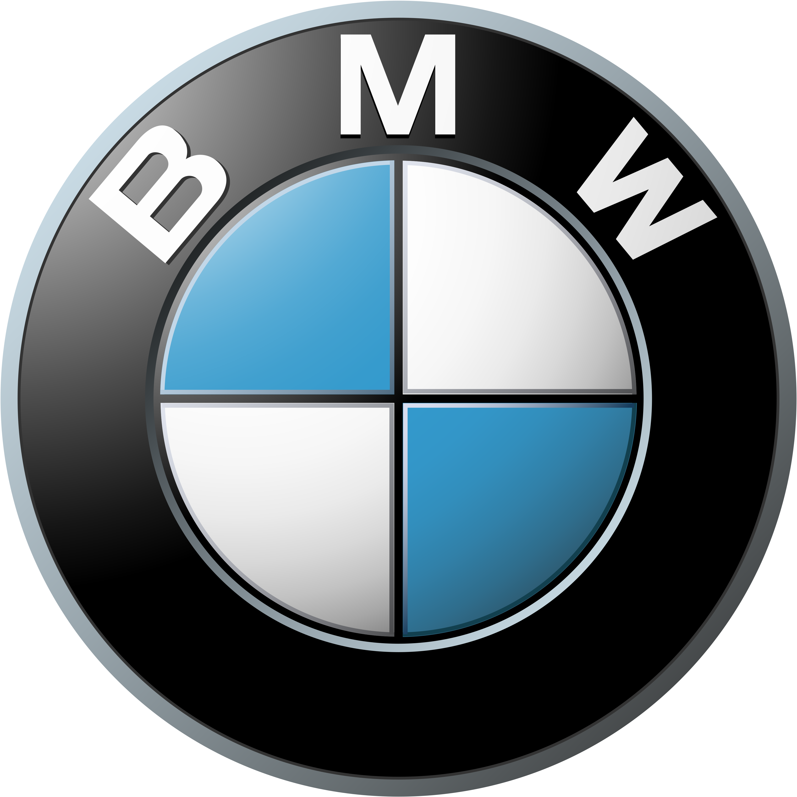
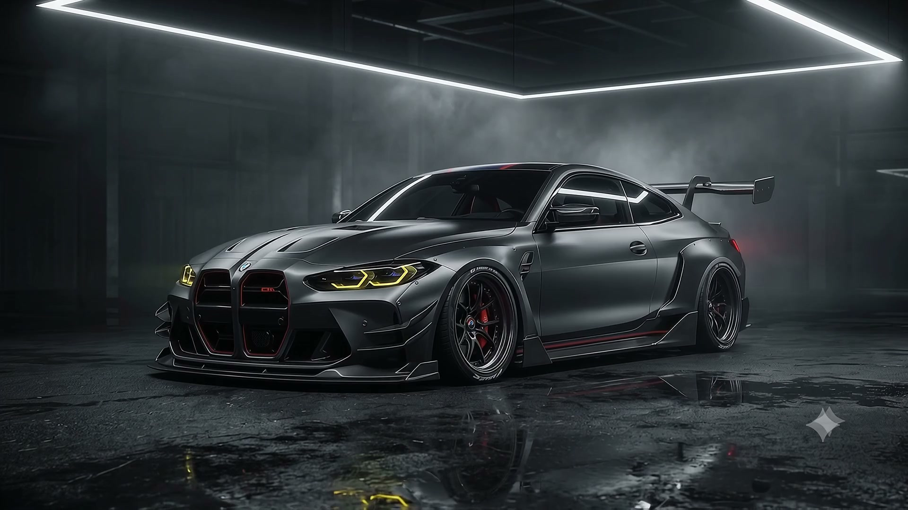
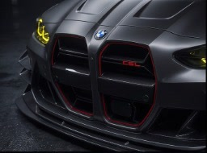
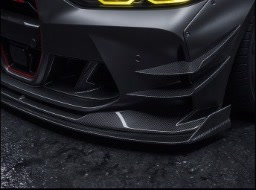
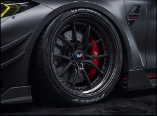
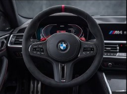
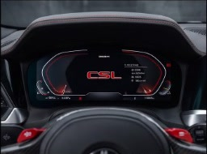
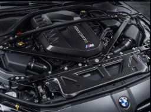
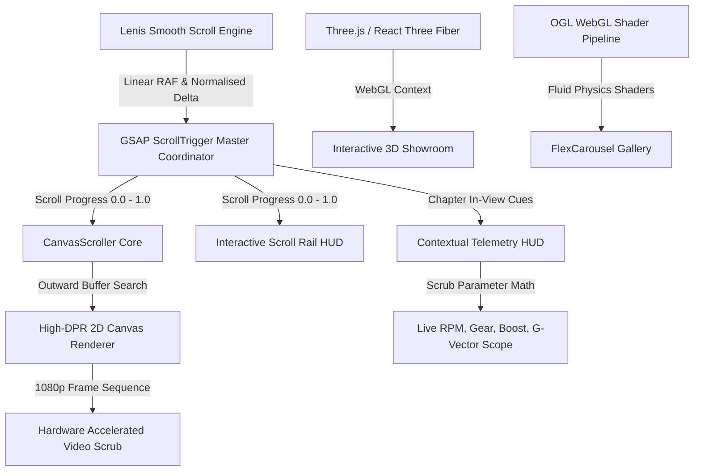

<div align="center">

  
  &nbsp;&nbsp;&nbsp;&nbsp;&nbsp;&nbsp;
  

  <br/><br/>

  # BMW M4 CSL (G82)
  ### COMPETITION SPORT LIGHTWEIGHT // CINEMATIC SCROLL EXPERIENCE
  **A tribute to 50 Years of BMW M Motorsport • Limited to 1,000 Units Worldwide**

  <p align="center">
    <a href="https://react.dev"></a>
    <a href="https://vitejs.dev"></a>
    <a href="https://threejs.org"></a>
    <a href="https://greensock.com/gsap/"></a>
    <a href="https://github.com/oframe/ogl"></a>
    <a href="https://lenis.darkroom.engineering/"></a>
  </p>

  <p align="center">
    <b>Nürburgring Nordschleife Lap Record: 7:15.677 min</b><br/>
    <i>550 HP // 650 Nm // -100 kg DIN Weight Reduction // 0-100 km/h in 3.7s</i>
  </p>

</div>

---

<p align="center">
  
</p>

---

## ⚡ Overview

The **BMW M4 CSL (G82) Cinematic Experience** is an ultra-high-performance, web-native interactive showcase designed with pure motorsport precision. Inspired by the uncompromising engineering of BMW M GmbH's 50th-anniversary track weapon, this project blends **60fps hardware-accelerated 1080p canvas scrubbing**, **real-time Three.js 3D model inspection**, **liquid WebGL shader distortion carousels**, and an **intelligent live telemetry HUD**.

Every pixel follows an unyielding aesthetic standard: **0px border-radii, hairline 1px borders, carbon-weave backdrops, technical monospace telemetry, and signature BMW M tricolor accents.**

---

## 🏁 Key Features & Innovations

### 1. 🎞️ Zero-Latency 1080p Canvas Scrubbing Engine
- **Continuous 650vh scrubbing journeys** across 4 sequences (Studio Reveal, Cockpit Aperture, High-Speed Track Sweep, Dynamic 360° Revolve).
- **Outward Nearest-Frame Cache Search:** Eliminates blank flickering frames during rapid user scrubbing with instantaneous proximity resolution.
- **Dynamic DPR Compensation:** Automatically targets the exact device pixel ratio buffer (up to 2×) with `imageSmoothingQuality: high`.

### 2. 🕹️ Dynamic Context-Aware Motorsport Telemetry HUD
- **Real-Time Live Scrub Telemetry:** As you scroll, real-time algorithms calculate simulated track velocity ($145 \to 307\text{ km/h}$), engine RPM ($4,200 \to 7,200\text{ RPM}$), active gear shifting ($M4 \to M7$), and boost pressure ($1.4 \to 2.1\text{ bar}$).
- **Shift Light Indicator Array:** 12-segment motorsport shift lights transitioning dynamically from green to yellow to flashing red.
- **Biaxial G-Vector Scope:** Live simulation of lateral and longitudinal gravitational forces acting on the chassis.
- **Pedal Input & Tyre Telemetry:** Active throttle/brake percentages and Michelin Pilot Sport Cup 2 R temperature/pressure readouts.
- **Context-Switching Profiles:** Automatically shifts layout between Studio Homologation Scanner, Cockpit Ergonomics Inspector, and Track Lap Telemetry.

### 3. 🧊 Interactive 3D Engineering Lab (Three.js / R3F)
- Explore the **complete M4 CSL chassis**, **CFRP full-bucket racing seats**, **high-downforce carbon wing**, and **twin-turbo S58 power unit**.
- **Engineered OrbitControls:** Smooth drag-to-rotate inspection with decoupled scroll dynamics (`enableZoom={false}`) to ensure seamless vertical page navigation.
- **Auto-Framing Bounds:** Camera matrix utilizes `<Bounds fit clip observe margin={1.2}>` and `<Center>` to eliminate clipping across viewport aspect ratios.

### 4. 🌊 WebGL Fluid Liquid Distortion Carousel (OGL)
- Powered by React Bits and OGL, featuring interactive mouse/touch drag fluid displacement shaders.
- Showcases the high-resolution homologation photographic gallery with chromatic dispersion, inertia momentum, and interactive photo zoom.

### 5. 🎯 Motorsport UX & Bespoke Interaction Systems
- **Calibrated Lenis Wheel Dampening:** Engineered scroll physics tuned for deliberate, heavy mechanical resistance mimicking race rack steering.
- **Interactive Telemetry Scroll Rail:** Right-aligned quick-jump index tracking real-time scroll progression with millimeter-accurate indicator crosshairs.
- **Custom Precision Cursor:** Styled crosshair reticle cursor tracking user interaction across all interactive zones.

---

## 🗺️ The 10-Chapter Architecture

| Chapter | Codename | Interactive Tech | Engineering Focus |
|:---:|:---|:---|:---|
| **01** | `STUDIO REVEAL` | 1080p Canvas Scrubbing | G82 Chassis reveal, dimensions (4,794mm × 1,921mm × 1,386mm) |
| **02** | `AERO SCULPTURE` | GSAP Micro-Animations | CFRP vented bonnet, roof indentation, ducktail boot lid |
| **03** | `COCKPIT CELL` | Door Sequence Canvas | M Carbon full bucket seats, deleted rear bench (-21 kg) |
| **04** | `MASS DELTA` | Technical Comparison HUD | Complete -100.0 kg lightweight breakdown matrix |
| **05** | `TRACK SWEEP` | High-Speed Track Scrubbing | High-speed lateral dynamics, active M differential lock |
| **06** | `S58 POWERTRAIN` | Dynamic Boost & Dyno HUD | 3.0L Inline-6 Twin-Turbo, 550 HP, 650 Nm, 2.1 bar boost |
| **07** | `360° REVOLVE` | Cinematic Orbital Canvas | Frozen Brooklyn Grey Metallic, exposed CFRP contours |
| **08** | `3D LAB` | Three.js / R3F WebGL | Full 3D model inspection (Exterior, Cockpit, Aero, Engine) |
| **09** | `GALLERY` | OGL Liquid Shader Carousel | 12 high-resolution homologation archive photographs |
| **10** | `HOMOLOGATION` | Tabular Spec Sheet Archive | Ring record lap time (7:15.677), full technical dossier |

---

## 📸 Photographic Gallery Showcase

<p align="center">
  
  
  
</p>
<p align="center">
  
  
  
</p>

---

## ⚙️ Technical Architecture



---

## 🎨 Design System & Motorsport Tokens

| Token | Value | Motorsport Application |
|:---|:---|:---|
| `--bg-dark` | `#0b0c0e` | Carbon Fibre Monocoque Deep Black |
| `--surface` | `#111317` | Technical Instrument Panel Background |
| `--accent` | `#ff3b1d` | BMW M Motorsport Competition Red |
| `--m-blue-light` | `#1b4899` | BMW M Heritage Light Blue |
| `--m-blue-dark` | `#112347` | BMW M Heritage Dark Navy |
| `--text` | `#eceae4` | Matte Titanium White Primary Typography |
| `--text-dim` | `#6b7280` | Technical Annotation Micro-Copy |
| `--line` | `rgba(255, 255, 255, 0.12)` | Hairline 1px Precision CAD Grid Separators |
| `--radius` | `0px` | Strict Zero-Radius Aerospace/Race Standard |

---

## 🚀 Quick Start Guide

### Prerequisites
- **Node.js**: v18.0.0 or higher
- **npm** or **pnpm** or **yarn**

### Installation

1. **Clone the repository:**
   ```bash
   git clone https://github.com/rudarsharma382-cell/Bmw-m4-csl.git
   cd Bmw-m4-csl
   ```

2. **Install project dependencies:**
   ```bash
   npm install
   ```

3. **Start local development server:**
   ```bash
   npm run dev
   ```
   Open [http://localhost:3000](http://localhost:3000) in your browser.

4. **Compile production build:**
   ```bash
   npm run build
   ```

5. **Preview production bundle:**
   ```bash
   npm run preview
   ```

---

## 🛠️ Technology Stack Breakdown

- **Core Framework**: [React 19](https://react.dev/) + [Vite 6](https://vitejs.dev/)
- **Animation & Scroll Choreography**: [GSAP](https://greensock.com/) + [ScrollTrigger](https://greensock.com/scrolltrigger/)
- **Smooth Scroll Physics**: [@studio-freight/lenis](https://lenis.darkroom.engineering/)
- **3D Graphics & Spatial Rendering**: [Three.js](https://threejs.org/) + [@react-three/fiber](https://docs.pmnd.rs/react-three-fiber/) + [@react-three/drei](https://github.com/pmndrs/drei)
- **Shader Carousel**: [OGL](https://github.com/oframe/ogl) + React Bits FlexCarousel
- **Styling Architecture**: Vanilla CSS Modular Tokens + Hairline Motorsport Grid

---

## 🏆 BMW M4 CSL (G82) Technical Specifications

```text
================================================================================
ENGINE                3.0-Litre M TwinPower Turbo Inline 6-Cylinder (S58)
MAXIMUM OUTPUT        550 HP (405 kW) @ 6,250 RPM
PEAK TORQUE           650 Nm (479 lb-ft) @ 2,750 – 5,950 RPM
BOOST PRESSURE        2.1 Bar (30.5 PSI)
TRANSMISSION          8-Speed M Steptronic with Drivelogic
DRIVETRAIN            Rear-Wheel Drive (RWD) with Active M Differential
0 – 100 KM/H (62 MPH) 3.7 seconds
0 – 200 KM/H (124 MPH)10.7 seconds
TOP SPEED             307 km/h (191 mph) [Electronically Governed]
KERB WEIGHT (DIN)     1,625 kg (-100 kg vs M4 Competition)
POWER-TO-WEIGHT       2.95 kg/hp (4.01 kg/kW)
NÜRBURGRING TIME      7:15.677 min (20.832 km full lap)
PRODUCTION RUN        Strictly limited to 1,000 units worldwide
================================================================================
```

---

## 📄 License & Fair Use

This project is built for creative portfolio and educational design exploration celebrating BMW M GmbH's historic 50-year milestone. BMW, M4, CSL, and the BMW Roundel////M logos are trademarks of **Bayerische Motoren Werke AG**.

MIT License © 2026. Built with extreme passion for motorsport engineering.
